<p align="center">
  
</p>

<h1 align="center">Brain Bean</h1>

<p align="center">
  <b>An Android app that counts the reels and shorts you scroll — and helps you stop.</b><br>
  Instagram · YouTube Shorts · TikTok · Facebook · Snapchat · Reddit
</p>

<p align="center">
  
  
  
  
  
  
  
</p>

---

## Overview

Most people think they watch "a few" reels a day. The real number is usually in the hundreds. **Brain Bean** makes that number visible in real time and gives you gentle (or strict) ways to stop.

A friendly brain mascot sits on top of the reel apps, **eats each reel you watch**, and slowly gets tired — then melts — as you approach your daily limit. When you reach it, Brain Bean steps in with a breathing break, a "write a reason" checkpoint or a hard lock, depending on how strict you want to be.

<p align="center">
  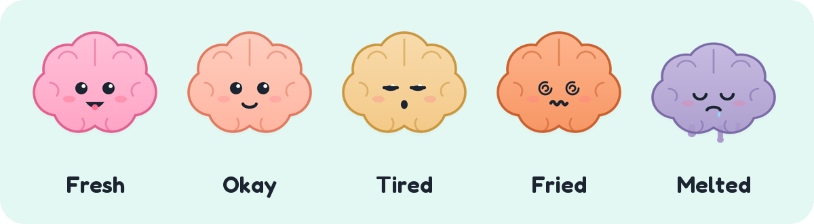
</p>

> **Status:** feature-complete, in closed beta on Android. Built and tested on real devices (Samsung Galaxy S8, Android 9).

---

## Screenshots

| Home | Floating counter | Gentle lock |
|:---:|:---:|:---:|
| 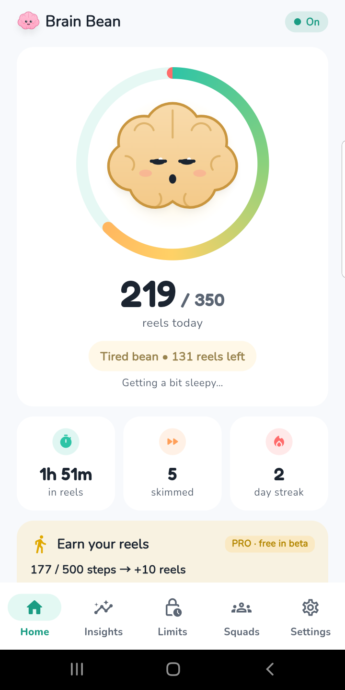 | 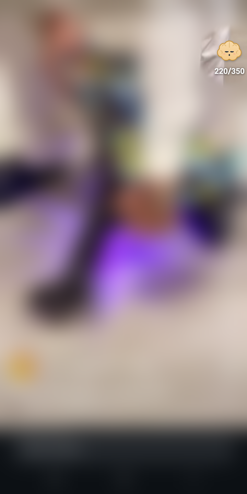 | 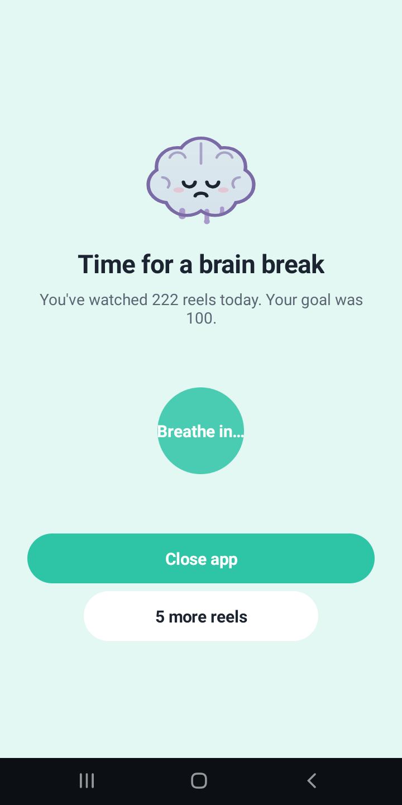 |
| **Insights** | **Weekly Reel Receipt** | **Limits & locks** |
| 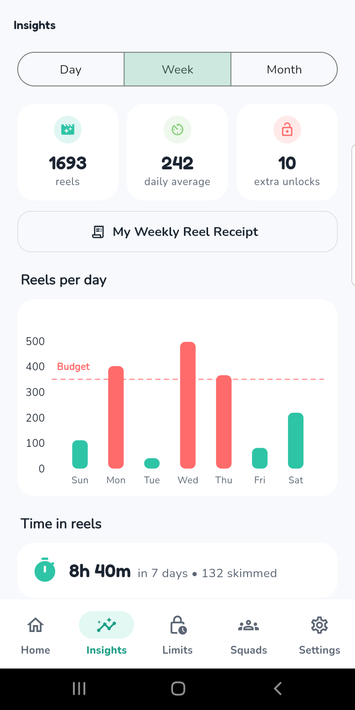 | 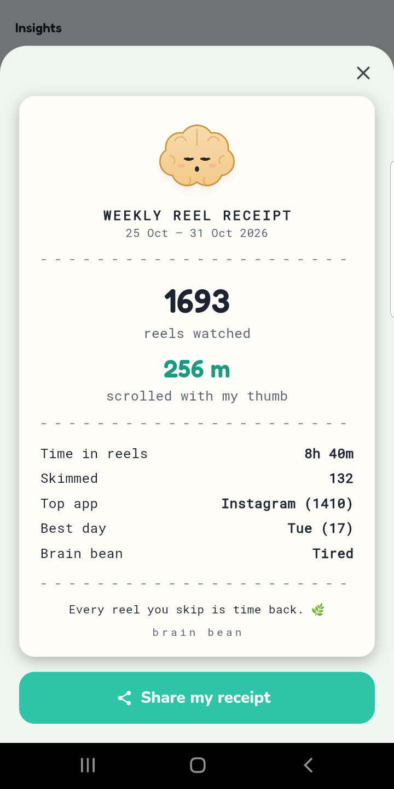 | 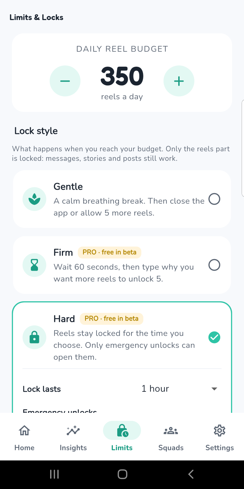 |
| **Squads** | **Firm lock: reason** | **Settings** |
| 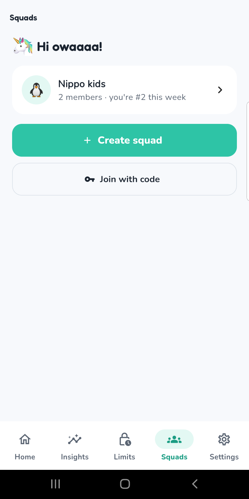 | 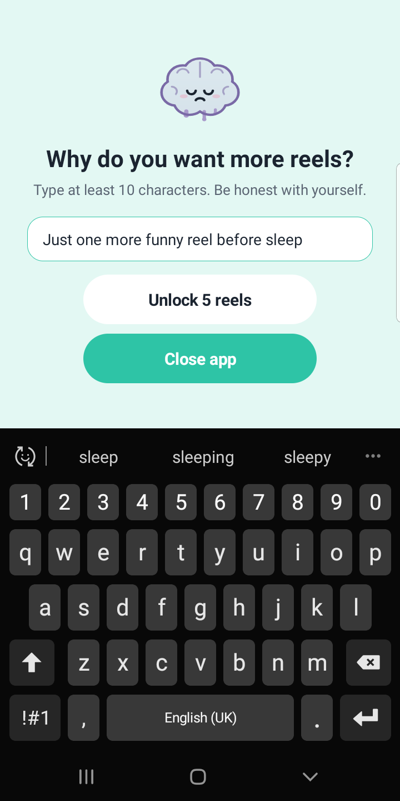 | 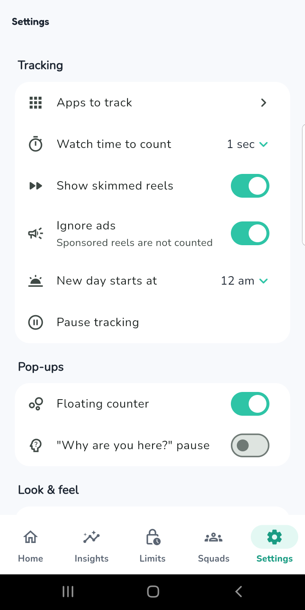 |

---

## Features

### Counting
- **Counts reels and shorts across 6 apps** — Instagram, YouTube Shorts, TikTok, Facebook, Snapchat, Reddit (plus Instagram Lite and Facebook Lite).
- **Watched vs. skimmed:** a reel counts once you stay on it for a set time (1–5 s); quick flicks are shown separately.
- **Never counts the same reel twice** in a day, even when you scroll back and forth. Ads are ignored.
- **Floating counter:** a draggable brain over the reel app that opens its mouth on every swipe and *eats* the old number when a reel counts.
- Only the apps you pick are watched; newly installed supported apps are added automatically.

### Limits & locks
- **Daily reel budget** with three lock styles:
  - **Gentle** — a breathing break, then "close app" or "5 more reels".
  - **Firm** — a 60-second wait, then you have to write *why* you want more.
  - **Hard** — reels stay locked until tomorrow (with a limited number of weekly emergency unlocks).
- **Schedules** (Bedtime, Study, Work…) that block reels at set times.
- **Per-app budgets** (e.g. only 20 Instagram reels a day).
- **"Why are you here?" pause** before reels open.
- **Earn your reels:** walk (step counter) or finish a focus session to earn extra reels.
- Warnings at 50 %, 80 % and 100 % of the budget.

### Insights
- Day / week / month charts, time spent, top apps, streaks.
- **Trigger patterns:** when in the day and week you scroll most.
- **Weekly Reel Receipt** — a shareable "receipt" of your week in reels.
- Home-screen widget.

### Squads (social)
- Private groups of 2–8 friends with a **weekly leaderboard** (fewest reels wins).
- **Nudges:** send a friend a push notification (rate-limited to 3 per friend per hour).
- Invite codes, owner controls, automatic clean-up of inactive members.

### Accounts & data
- Sign in with **Google** or as a **guest**; upgrade a guest account to Google anytime.
- **Cloud backup & restore** that merges correctly across phones without double counting.
- Export to **CSV** or a backup file; one-tap **online account deletion**.
- **Reliability Doctor:** checks the counter keeps running and gives phone-specific fixes (Samsung, Xiaomi, Oppo, Vivo, Huawei…).

---

## Architecture

Brain Bean is split into a **Flutter UI** and a **native Kotlin engine**. Counting and locks must keep working while the app's own screens are closed, so they live in an Android `AccessibilityService`; Flutter talks to it over platform channels.

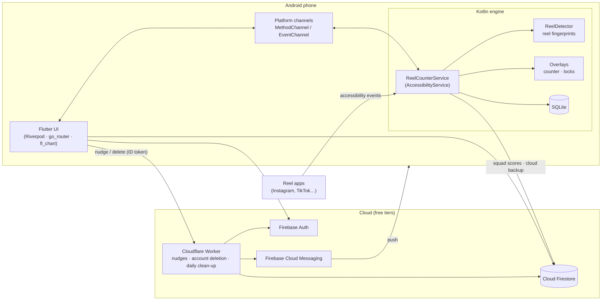

| Layer | Responsibility | Key files |
|---|---|---|
| Flutter UI | Screens, charts, settings, Squads | `lib/features/`, `lib/core/` |
| Platform bridge | Flutter ↔ Kotlin calls and live updates | `lib/core/native_bridge.dart`, `NativeBridge.kt` |
| Counting engine | Watches the reel apps, counts reels, enforces limits | `service/ReelCounterService.kt` |
| Reel detection | Finds the reels screen and fingerprints each reel, per app | `service/ReelDetector.kt`, `core/TargetApps.kt` |
| Overlays | Floating counter, lock screens, "Why are you here?" | `service/Overlays.kt`, `service/BrainView.kt` |
| Storage | Local history and settings | `core/Db.kt` (SQLite), `core/Config.kt` |
| Cloud sync | Squad scores, cloud backup | `core/SquadSync.kt`, `core/CloudBackup.kt` |
| Serverless backend | Push nudges, one-tap account deletion, daily squad clean-up | `worker/src/index.js` |
| Security rules | Who can read/write what in Firestore | `firestore.rules` |

---

## Engineering highlights

**1. Counting each reel exactly once.**
Brain Bean reads other apps' screens through the Android Accessibility API, so it has to recognise a reel from the text on screen. Each reel gets a *fingerprint* built from its most stable texts (caption, creator), leaving out everything that changes between visits — like counts, music lines, buttons, "AI content" labels. Two safety nets catch the rest: a **feed-position check** (Instagram and Facebook report which reel is on screen) and a **caption-and-text similarity check** (for TikTok and YouTube). Verified with scripted forward-and-back swipe tests over ADB on four apps: **every video counted once, zero double counts.**

**2. A zero-cost serverless backend.**
Firebase's free plan has no Cloud Functions, so a **Cloudflare Worker** does the privileged work: it verifies Firebase ID tokens against Google's public keys, mints a service-account OAuth token, talks to Firestore over REST, sends pushes through **FCM v1**, deletes accounts with admin rights (so users never have to re-sign-in to delete), and runs a **daily cron** that removes inactive squad members.

**3. Security by design.**
Firestore Security Rules enforce ownership (only you write your scores; squad scores can't go down within a week; only the owner can delete a squad). The service-account key exists only as a Worker secret — never in the app or this repo. Only reel *counts* are shared with squads, never which reels, apps or times.

**4. Native overlays that never trap the user.**
Lock screens are accessibility overlays drawn on top of other apps. Home, Back and the navigation bar always work; turning the screen off on a lock sends the reel app home on unlock so it can't keep playing; the "write a reason" step opens as a normal app screen so the keyboard and navigation behave correctly on every phone.

**5. Fast, reliable release builds.**
A seamless **1.2 s cold start** (Android's start-up screen and the Flutter splash are pixel-identical; Firebase starts behind the splash). A release-only hang caused by **R8 code shrinking** removing code that a plugin calls by name was found and fixed with keep rules.

**6. Data that survives phone changes.**
Cloud backup uploads per-day summaries; restore only fills days the phone has no data for, and later reels are added on top — so nothing is lost or counted twice. A fresh phone can't overwrite your real settings in the cloud before you restore them.

---

## Tech stack

| Area | Technologies |
|---|---|
| **App (UI)** | Flutter 3.44, Dart 3.12, Riverpod 3 (state), go_router 17 (navigation), fl_chart (charts), flutter_animate, Google Fonts, Material 3 |
| **Android native** | Kotlin, `AccessibilityService`, accessibility overlay windows, BroadcastReceivers, step-counter sensor, AppWidget, platform channels |
| **Storage** | SQLite (on-device), SharedPreferences |
| **Cloud** | Firebase Authentication (Google Sign-In, anonymous), Cloud Firestore, Firestore Security Rules, Firebase Cloud Messaging, Firebase Crashlytics |
| **Serverless** | Cloudflare Workers (JavaScript), cron triggers, JWT/JWK verification, Google service-account OAuth, Firestore REST API |
| **Build & tooling** | Gradle (Kotlin DSL), R8/ProGuard, Firebase CLI, Wrangler, ADB, Git & GitHub |
| **Testing** | Flutter unit/widget tests, scripted on-device tests over ADB (automated swipes + log analysis) |

---

## Project structure

```
lib/                      Flutter app
├─ core/                  models, providers, platform bridge, Squads, nudges, start-up
├─ features/              home · insights · limits · squads · settings · onboarding · doctor · pro
├─ theme/                 colours and typography
└─ widgets/               the brain mascot and shared widgets
android/app/src/main/kotlin/com/brainbean/app/
├─ service/               ReelCounterService, ReelDetector, Overlays, BrainView, Notifier, ReasonActivity
├─ core/                  Config, Db (SQLite), TargetApps, SquadSync, CloudBackup
└─ widget/                home-screen widget
worker/                   Cloudflare Worker (nudges, account deletion, daily clean-up)
firestore.rules           Firestore security rules
tool/                     scripts that render the icon, splash and mascot images
test/                     unit and widget tests
```

---

## Getting started

**Requirements:** Flutter 3.44+, Android SDK, an Android 8.0+ phone (the counter needs a real device; emulators don't run the reel apps).

```bash
git clone https://github.com/ahmadfurrokh29/Brain-Buddy.git
cd Brain-Buddy
flutter pub get
flutter run --release
```

On the phone, Brain Bean's setup walks you through switching on **Settings → Accessibility → Brain Bean reel counter** and allowing it to run in the background.

<details>
<summary><b>Using your own Firebase project and Worker</b></summary>

1. Create a Firebase project with **Authentication** (Google + Anonymous), **Cloud Firestore** and **Cloud Messaging** enabled.
2. Register an Android app with package `com.brainbean.app`, add your signing key's SHA-1/SHA-256, and replace `android/app/google-services.json` and `lib/firebase_options.dart` (e.g. with `flutterfire configure`).
3. Deploy the security rules: `firebase deploy --only firestore:rules`.
4. Deploy the Worker from `worker/`: set the secret with `npx wrangler secret put FIREBASE_SERVICE_ACCOUNT` (a service-account key — never commit it), then `npx wrangler deploy`. Put the Worker URL in `lib/core/nudges.dart`.

</details>

### Tests

```bash
flutter analyze
flutter test
```

---

## Privacy

- Brain Bean only looks at the apps you choose, and only to count reels. It never reads messages, passwords or anything you type, and never stores screenshots or reel content.
- Your reel history stays on your phone. It's shared only if **you** use Squads (your nickname and reel *counts*) or turn on Cloud backup (daily totals, in your own Google account).
- You can delete your online account and everything in it at any time, from inside the app.

---

## Roadmap

- [x] Counting engine, mascot, budgets and locks
- [x] Schedules, per-app budgets, Earn your reels, trigger insights
- [x] Squads, nudges, cloud backup, Weekly Reel Receipt
- [ ] Google Play closed testing → public release
- [ ] Quick-message nudges ("Put the phone down! 📵")

---

## Author

**Ahmad Furrokh** — designed and built Brain Bean end to end: product, UI, native Android engine, backend and testing.

> Brain Bean is an independent project and is not affiliated with Instagram, YouTube, TikTok, Facebook, Snapchat or Reddit. All trademarks belong to their owners.
